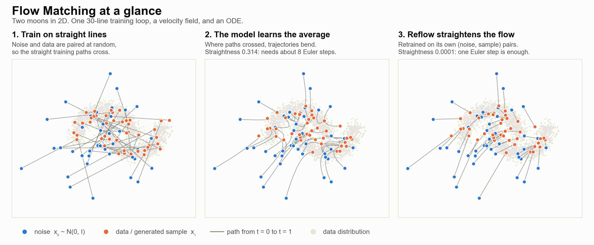

# Flow Matching for World Models

*How a velocity field learned by plain regression becomes a simulator, an action labeller and a policy: from the continuity equation to NVIDIA's Cosmos stack.*



*Generated by `scripts/make_hero_figure.py` from the two-moons model in this repository.*

## The Problem

A world model predicts what happens next in a physical scene: given the video so far and an action, it generates the future. Futures are multimodal (a ball can bounce left or right), so a model trained with mean squared error returns the *average* future, which is often physically impossible. Flow matching is the generative objective behind Stable Diffusion 3, Cosmos-Predict2.5, Cosmos 3, GR00T and π0. This guide explains it from first principles, shows how the published Cosmos stack uses it, and checks the core claims (the one-step trap, reflow, the code snippets) with a small experiment you can rerun on a CPU in about 20 seconds.

> **Scope.** Part II summarises published NVIDIA, GR00T and π0 work; no world model was trained for this repository. Every measured number in this README comes from the scripts listed in [section 15](#15-reproduce-the-numbers) and can be reproduced.

---

## Contents

| Part | Sections |
|---|---|
| **I · Flow matching** | [1 Transport](#1-generation-as-transport) · [2 Conditional FM](#2-conditional-flow-matching) · [3 Why it works](#3-why-regression-on-conflicting-labels-works) · [4 Paths](#4-paths-parameterisations-and-diffusion) · [5 One-step trap](#5-sampling-and-the-one-step-trap) · [6 Straightening](#6-straightening-and-distillation) · [7 Knobs at scale](#7-training-knobs-at-scale) · [8 Beyond pixels](#8-beyond-pixels) · [9 Conventions](#9-conventions-cheat-sheet) |
| **II · World models** | [10 Definition](#10-what-a-world-model-is) · [11 Cosmos stack](#11-the-cosmos-stack) · [12 Conditioning](#12-conditioning-a-world-model) · [13 Token roles](#13-token-roles-one-model-many-jobs) · [14 Using and judging](#14-using-and-judging-world-models) |
| **III · Run it** | [15 Reproduce the numbers](#15-reproduce-the-numbers) · [16 Takeaways and checklist](#16-takeaways-and-checklist) |
| **Back matter** | [Key equations](#key-equations-at-a-glance) · [References](#references) · [Glossary](#glossary) |

### What you will be able to do

1. Derive the conditional flow matching loss and explain why regressing on *conflicting* straight-line labels learns the right field.
2. Convert between velocity, data and noise predictions, between flow matching and diffusion (EDM), and between the time conventions of Meta, Cosmos, π0 and GR00T.
3. Explain why one sampling step of an undistilled model returns the conditional mean, and what reflow and distillation do about it.
4. Read a frontier world-model stack and know what each knob does: logit-normal time, resolution shift, guidance, frame conditioning, action injection, token roles, 4-step distillation.

---

# Part I · Flow matching

## 1. Generation as transport

**What:** Treat generation as moving probability mass from a simple noise density to the data density along a time t ∈ [0, 1].

**Why it matters**
- Real data occupies a thin, complicated region of ℝᵈ; it cannot be learned in one shot.
- Mass is conserved while it moves, so a velocity field is all we need.

**How.** The density pₜ and the velocity field uₜ that moves it obey the continuity equation:

$$
\partial_t \, p_t(x) + \nabla \cdot \big( p_t(x) \, u_t(x) \big) = 0
$$

Each sample follows the ODE ẋₜ = uₜ(xₜ), and a cloud of samples pushed along it is distributed as pₜ. Flow matching trains a network v<sub>θ</sub>(x, t) ≈ uₜ(x), then generates by drawing noise and integrating.

**Key point:** continuous normalizing flows (2018) used the same ODE but trained by maximum likelihood, integrating the ODE at every step, so they never scaled. Flow matching (Lipman et al., 2023) and rectified flow (Liu et al., 2022) are *simulation-free*: one network call per training example.

---

## 2. Conditional flow matching

**What:** Regress the network onto the velocity of a straight line between a noise sample and a data sample.

**Why it matters**
- There is no ground-truth velocity field for the whole data distribution.
- There *is* a simple one for a single data point x₁.

**How.** Move each noise sample in a straight line at constant speed:

$$
x_t = t \, x_1 + (1 - t) \, x_0, \qquad \frac{d x_t}{dt} = x_1 - x_0
$$

This is the optimal-transport path between a Gaussian and a point, hence the name **CondOT**. The loss is plain regression:

$$
\mathcal{L}_{\text{CFM}}(\theta) = \mathbb{E}_{t, \, x_0, \, x_1} \Big[ \big\lVert v_\theta(x_t, t) - (x_1 - x_0) \big\rVert^2 \Big]
$$

With Meta's library the whole loop is a dozen lines:

```python
# pip install flow_matching   (Meta, CC BY-NC 4.0)
import torch
from flow_matching.path import CondOTProbPath
from flow_matching.solver import ODESolver

path = CondOTProbPath()              # x_t = t*x1 + (1-t)*x0, target dx_t = x1 - x0
opt = torch.optim.Adam(model.parameters(), lr=1e-3)
for step in range(8000):
    x1 = sample_data(2048)
    x0 = torch.randn_like(x1)
    s = path.sample(x_0=x0, x_1=x1, t=torch.rand(x1.shape[0]))
    loss = (model(s.x_t, s.t) - s.dx_t).pow(2).mean()
    opt.zero_grad(); loss.backward(); opt.step()

samples = ODESolver(velocity_model=model).sample(
    x_init=torch.randn(5000, 2), step_size=1 / 32, method="euler")
```

**Key point:** it looks naive. Pairs are random, the label is constant in time, and every training path is straight while the true flow is curved. Section 3 explains why that works.

---

## 3. Why regression on conflicting labels works

**What:** Two straight training lines can cross, giving the same input (xₜ, t) two different labels. MSE resolves the conflict by learning their conditional expectation.

**Why it matters:** that expectation is exactly the marginal field that transports noise to data.

**How.**

$$
v^\star(x, t) = \mathbb{E}\big[ x_1 - x_0 \,\big|\, x_t = x \big]
$$

The conditional loss and the intractable marginal loss differ by a constant, so they have the same gradients. The conflicting labels are the mechanism, not a nuisance.

**Consequences**
- **The field depends on time** even though each label is constant: the conditional field (x₁ − x) / (1 − t) grows as time runs out.
- **Learned paths curve and never cross**, because ODE solutions are unique. On two moons in this repository, straightness is 0.314 for the learned flow and 0.0001 after one reflow (section 6).
- **A closed form exists for testing.** For data made of points μᵢ with weights πᵢ:

$$
v(x, t) = \sum_i w_i(x, t) \, \frac{\mu_i - x}{1 - t}, \qquad w_i \propto \pi_i \, \mathcal{N}\big(x;\ t \mu_i,\ (1 - t)^2\big)
$$

---

## 4. Paths, parameterisations and diffusion

**What:** The straight line is one member of the affine Gaussian paths xₜ = αₜ x₁ + σₜ x₀, whose velocity is α̇ₜ x₁ + σ̇ₜ x₀.

**Why it matters:** diffusion and flow matching are one family, so schedules, checkpoints and prediction targets can be converted exactly.

**Schedulers in Meta's library**

| Scheduler | αₜ | σₜ | Used by |
|---|---|---|---|
| `CondOTScheduler` | t | 1 − t | flow matching, rectified flow, Cosmos-Predict2.5, Cosmos 3 |
| `VPScheduler` | exp(−T(t) / 2) | √(1 − exp(−T(t))) | DDPM / VP-SDE probability-flow ODE |
| `CosineScheduler` | sin(πt / 2) | cos(πt / 2) | cosine schedules |
| `LinearVPScheduler` | t | √(1 − t²) | variance-preserving linear |
| `PolynomialConvexScheduler(n)` | tⁿ | 1 − tⁿ | discrete mixture paths |

**Converting predictions (CondOT path)**

| Have | Get | Formula |
|---|---|---|
| clean data x̂₁ | velocity | u = (x̂₁ − xₜ) / (1 − t) |
| noise ε̂ | velocity | u = (xₜ − ε̂) / t |
| velocity u | clean data | x̂₁ = xₜ + (1 − t) u |
| noise ε̂ | score | ∇ log pₜ(x) = −ε̂ / σₜ |

**Link to diffusion.** With Gaussian paths, flow matching and diffusion share marginals up to a re-parameterisation of time; Meta's `ScheduleTransformedModel` switches scheduler without retraining. They differ only in network output, loss weighting, training-time distribution and sampler. The map to EDM's noise level, in Meta time, is:

$$
\sigma_{\text{EDM}} = \frac{1 - t}{t}
$$

**Key point:** AlphaFlow predicts clean structures and Cosmos predicts velocity; once the clock is aligned the ODE is the same. Cosmos-Predict2.5 (p. 8): FM and EDM "are mathematically equivalent… FM selects coefficients that make the denoising network predict the velocity of the diffusion trajectory."

---

## 5. Sampling, and the one-step trap

**What:** Sampling integrates the learned ODE from noise (t = 0) to data (t = 1).

**Why it matters:** each step is one network call, so the step count is the inference cost, and too few steps fail in a specific way.

**How.** Euler takes one call per step:

$$
x_{t+h} = x_t + h \, v_\theta(x_t, t)
$$

Midpoint and Heun use two calls per step, RK4 four; multistep solvers such as UniPC (Cosmos 3) reuse past calls.

**The trap.** With independent noise–data pairs, x₀ carries no information about x₁, so a single step lands on the conditional mean:

$$
x_0 + 1 \cdot v^\star(x_0, 0 \mid c) = \mathbb{E}[x_1 \mid c]
$$

**Key point:** one Euler step of an undistilled flow is exactly what an MSE regressor predicts: for a world model, a blurry and often impossible average of futures. Measured on two moons: at one Euler step, vanilla flow matching is 13× further from the data than at 64 steps (sliced W₂ 0.626 vs 0.049; table in section 6).

---

## 6. Straightening and distillation

**What:** Rectified flow (reflow) retrains on (noise, sample) pairs produced by the trained model itself.

**Why it matters**
- Curvature comes from crossings, and crossings come from random pairing.
- Straight trajectories allow one- or few-step sampling.

**How.** Draw z₀, integrate to z₁, retrain on the fixed pairs. Straightness is measured as:

$$
S = \int_0^1 \mathbb{E} \Big[ \big\lVert (Z_1 - Z_0) - v(Z_t, t) \big\rVert^2 \Big] \, dt, \qquad S = 0 \text{ means perfectly straight}
$$

```python
z0 = torch.randn(60_000, 2)
z1 = ODESolver(velocity_model=m1).sample(x_init=z0, step_size=1/128, method="midpoint")
# warm-start m2 from m1; train with the same CFM loss on the fixed pairs (z0[i], z1[i])
```

**Measured on two moons** (`scripts/check_readme_claims.py`, seed 0; sliced W₂ to the data, lower is better; two fresh data samples differ by 0.007)

| Model | 1 step | 2 steps | 4 steps | 8 steps | 64 steps | Straightness |
|---|---|---|---|---|---|---|
| Vanilla flow matching | 0.626 | 0.368 | 0.184 | 0.109 | 0.049 | 0.314 |
| After one reflow | **0.046** | 0.045 | 0.045 | 0.047 | 0.044 | 0.0001 |

One reflow step matches 64 vanilla steps: a 64× cut in network calls at equal quality on this toy. Liu et al. show *repeated* reflow drives straightness toward zero, not that one round reaches it.

**Production relatives**

| Method | Idea | Where it appears |
|---|---|---|
| Reflow | retrain on the model's own coupling | this repository: 1-step reflow ≈ 64-step vanilla on two moons |
| One-step distillation | student regresses the teacher's full-sampler output | AlphaFlow: 10 → 1 network calls (repository defaults) |
| rCM | consistency distillation + distribution matching | Cosmos-Predict2.5-2B at 4 steps; PAI-Bench text-to-world 0.768 → 0.764 |
| DMD2 | student + fake-score critic + distribution-matching gradient | Cosmos 3: 4-step students with guidance baked in |
| Shortcut, MeanFlow | learn the average velocity over an interval | research alternatives |

**Key point:** NVIDIA reports its 4-step DMD2 students as "17–25x faster". One plausible reading: 35–50 teacher steps × 2 passes for guidance = 70–100 network calls, against 4.

---

## 7. Training knobs at scale

### 7.1 Training-time distribution

**What:** Where in [0, 1] the training times t are drawn.

**Why it matters:** uniform t wastes capacity on trivial and hopeless noise levels. Which outcome happens is decided at high noise; the detail at low noise.

**How.** SD3 and Cosmos-Predict2.5 use a logit-normal:

$$
t = \operatorname{sigmoid}(n), \qquad n \sim \mathcal{N}(m, s^2)
$$

Cosmos 3 draws the noise level independently for each modality: logit-normal for image, audio and action batches, and "mode sampling" for video.

### 7.2 Resolution shift

**What:** Push noise levels up as resolution grows.

**Why it matters:** at high resolution neighbouring pixels are redundant, so a given noise level destroys less structure.

**How.** In Cosmos time (1 = noise):

$$
t_s = \frac{\beta t}{1 + (\beta - 1) t} \quad \Longleftrightarrow \quad \frac{t_s}{1 - t_s} = \beta \, \frac{t}{1 - t}
$$

The shift multiplies the noise-to-signal ratio by β (the variance ratio by β²). Cosmos 3's 4-step schedule `[1.0, 0.9375, 0.8333, 0.625]` is exactly β = 5 applied to `[1, 0.75, 0.5, 0.25]`.

| Where | 256p | 480p | 720p |
|---|---|---|---|
| Cosmos-Predict2.5 training | β = 1 | — | β = 5 |
| Cosmos 3 pre-training | 1 | 3 | 5 |
| Cosmos 3 mid-training | 3 | 5 | 10 |
| Cosmos 3 inference | 10 (video), 3 (text-to-image), 5 (image-to-video, actions, policy) | | |

Predict2.5 also sharply reduced abrupt frame transitions by drawing 5% of training samples from the highest 2% of the noise distribution: temporal coherence is decided at high noise.

### 7.3 Loss and masking

- Velocity MSE with no time-dependent weighting (Cosmos 3 adds per-modality loss scales).
- Clean conditioning tokens (context frames, given actions) are masked out of the loss.
- Cosmos 3 scales the action loss by 10 "to compensate for the smaller per-element MSE of normalized action vectors."

### 7.4 Classifier-free guidance

**What:** Drop the condition about 10% of the time in training; at sampling, extrapolate toward the conditional velocity:

$$
\tilde{v} = v_\varnothing + w \, (v_c - v_\varnothing)
$$

**Key knobs / gotchas**
- Guidance doubles the cost per step.
- Cosmos 3 uses w = 6 for video, w = 3 for policy, and **w = 1 (no guidance) for forward and inverse dynamics**. Our reading of why: guidance amplifies the condition, and a simulator should reproduce it.
- Meta's image example writes (1 + w′) v<sub>c</sub> − w′ v<sub>∅</sub>, so its `cfg_scale = 0.2` means w = 1.2.

---

## 8. Beyond pixels

| Domain | What changes | Example |
|---|---|---|
| **Manifolds** (Riemannian FM) | Straight line → geodesic xₜ = exp<sub>x₀</sub>(t · log<sub>x₀</sub> x₁); project after each step | Meta ships sphere and flat torus. Cosmos 3 instead encodes poses as 9-D relative SE(3) deltas: 9D vehicle, 10D single arm, 29D humanoid, 57D egocentric human |
| **Tokens** (discrete FM) | Each token follows (1 − κₜ) δ(x₀) + κₜ δ(x₁); cross-entropy or generalised-KL loss; sampling is a continuous-time Markov chain from a mask or uniform-noise source | the flow-matching view of masked token models |
| **Structure** (AlphaFlow) | Polymer-chain prior, noise aligned to data, distance-map inputs, x-prediction, 1-step distillation | Judged on distributions (RMSF, Wasserstein, PCA overlap), as any world model should be |
| **Actions** (policies) | Flow matching over action chunks | GR00T N1 and π0 use flow-matching action heads; see their papers for time sampling and step counts |

---

## 9. Conventions cheat sheet

**What:** The direction of time differs between codebases.

**Why it matters:** it is the most common bug when moving between them. Convert in exactly one place.

| Source | Noise at | Interpolant | Target | Integrate |
|---|---|---|---|---|
| Meta `flow_matching`, Lipman et al., GR00T code, this guide | t = 0 | t x₁ + (1 − t) x₀ | x₁ − x₀ | 0 → 1 |
| Cosmos-Predict2.5, Cosmos 3, SD3 | t = 1 | (1 − t) x + t ε | ε − x | 1 → 0 |
| openpi (π0), LeRobot pi0 / SmolVLA | t = 1 | t · noise + (1 − t) · actions | noise − actions | 1 → 0 |
| AlphaFlow paper | t = 0 (harmonic prior) | (1 − t) x₀ + t x₁ | step (x̂ − xₜ) / (1 − t) | 0 → 1 |
| AlphaFlow code | t = 1 | (1 − t) · data + t · noise | step (xₜ − x̂) / t | 1 → 0 |
| EDM / Cosmos-Predict1 | σ<sub>max</sub> | x + σε | denoiser D(x<sub>σ</sub>, σ) | σ<sub>max</sub> → 0 |

**Conversion rules**

$$
t_{\text{Meta}} = 1 - t_{\text{Cosmos}}, \qquad u_{\text{Meta}} = -v_{\text{Cosmos}}, \qquad \sigma_{\text{EDM}} = \frac{1 - t_{\text{Meta}}}{t_{\text{Meta}}} = \frac{t_{\text{Cosmos}}}{1 - t_{\text{Cosmos}}}
$$

**Gotchas**
- The π0 *paper* puts noise at τ = 0; the openpi *repository* matches the table row above.
- Equation (1) of the GR00T paper prints the target as ε − A, the wrong sign for its own interpolant; the code matches Meta.

---

# Part II · World models

## 10. What a world model is

**What:** Given the video so far x₀:ₜ and a control c (text, camera pose, ego trajectory, robot actions), predict the future:

$$
p_\theta \big( x_{t+1:T} \,\big|\, x_{0:t}, \, c \big)
$$

**Why it matters:** futures are multimodal, so the model must be generative. A regression model predicts the mean, and the mean of two futures is often impossible: a ball that can bounce left or right is predicted to go straight down. Section 5 shows that one step of an undistilled flow returns that same mean, and section 6 shows reflow fixing it.

**What world models are for**

| Use | What it means | Where it shows up |
|---|---|---|
| Synthetic data | photoreal variants; rare events you cannot stage | Cosmos Transfer, Predict |
| Action-conditioned rollout | frames + actions → future frames | Predict2.5 action model; Cosmos 3 forward dynamics |
| Policy evaluation | rank checkpoints in imagination | Cosmos surgical-simulator recipe |
| Planning | imagine futures for candidate actions, pick the best | model-predictive control |
| Neural trajectories | dream tasks, recover actions, train a policy | DreamGen / GR00T-Dreams |
| Policy | denoise actions jointly with video | Cosmos 3 policy mode |
| Critic | reject hallucinated generations | Cosmos Reason; best-of-N |

---

## 11. The Cosmos stack

**What:** NVIDIA's world foundation models moved from EDM diffusion (Predict1) to flow matching (Predict2.5) to one rectified-flow objective over video, audio and actions (Cosmos 3, June 2026).

| | Cosmos-Predict1 | Cosmos-Predict2.5 | Cosmos 3 |
|---|---|---|---|
| **Objective** | EDM denoising | flow matching, v = ε − x, logit-normal t, resolution shift | rectified flow over video, audio, actions; masked MSE; per-modality noise |
| **Backbone** | diffusion transformer (see [11]) | DiT 2B / 14B; 3D RoPE; AdaLN-LoRA | Mixture-of-Transformers: reasoner + generator towers, shared attention; 4B / 16B / 64B total |
| **Latents** | Cosmos tokenizer (see [11]) | Wan2.1 VAE 4×8×8; 93 frames → 24 latent frames | Wan2.2 VAE; audio 25 tokens/s |
| **Text** | T5 | Cosmos-Reason1 features, cross-attention | the reasoner tower itself |
| **Data** | 20M hours of video | 35M hours → ~200M clips (~4% kept) | 767M images + 347.7M clips; 8.4M action episodes |
| **Few-step** | — | rCM → 4 steps | DMD2 → 4 steps, guidance baked in |

**How Cosmos 3's shared attention works**
- Reasoner tokens (text, images) attend causally among themselves and never see noisy tokens, so their keys and values are computed once and reused at every denoising step.
- Generator tokens (noisy video, audio and action latents) attend to everything.

**Sampling defaults:** 35–50 UniPC steps, guidance 6, shift 10 for video; guidance 1 for dynamics; 4 steps with guidance 3 for the DROID policy.

**Headline results (Cosmos3-Super):** PAI-Bench-G 80.0 / 82.8 (text / image to video); Physics-IQ 43.8, rising to 48.9 with best-of-N.

---

## 12. Conditioning a world model

**What:** The generative core is generic; what makes it a *world* model is what it is conditioned on, and how.

| Signal | Mechanism | Evidence |
|---|---|---|
| Past frames | clean latents replace the first frames; a mask marks them; the loss skips them | Predict2.5 |
| Robot actions | MLP of the action added to the timestep embedding | Predict2.5 Table 20: PSNR 24.95 / FVD 146, vs cross-attention 24.41 / 159, vs concatenation 23.11 / 267 |
| Actions as tokens | actions are their own modality with an independently drawn noise level; clean or noisy depending on the mode | Cosmos 3 |
| Camera | Plücker ray maps added before self-attention | Predict2.5 |
| Dense controls | ControlNet branches → in-context control tokens | Transfer 1 / 2.5; Cosmos 3 |
| Multiple cameras | views concatenated along latent time | Predict2.5 AV multiview (7 views) |
| Long horizons | chunked autoregression | RNDS drift metric (Predict2.5 paper, reported on Transfer2.5) |

**Key point:** adding the action to the time embedding wins because it modulates every layer through adaptive layer norm, the same pathway that tells the network how noisy its input is.

---

## 13. Token roles: one model, many jobs

**What:** Every token is **clean** (given, t = 1, no loss), **noisy** (generated, with loss) or **dropped** (absent, or the guidance null).

**Why it matters:** which tokens are noisy defines the task, so one network serves as simulator (forward dynamics), action labeller (inverse dynamics), policy and video continuer.

**How.** Meta's `ProbPath.sample` takes one time per *sample*, but roles need one time per *token*, so interpolate with the scheduler directly:

```python
from flow_matching.path.scheduler import CondOTScheduler

def interpolate(x1, x0, t_tok, sched=CondOTScheduler()):
    """x1, x0: (B, N, ...); t_tok: (B, N) one flow time per token."""
    s = sched(t_tok)
    shape = t_tok.shape + (1,) * (x1.ndim - t_tok.ndim)
    a, sg = s.alpha_t.reshape(shape), s.sigma_t.reshape(shape)
    da, dsg = s.d_alpha_t.reshape(shape), s.d_sigma_t.reshape(shape)
    return a * x1 + sg * x0, da * x1 + dsg * x0      # x_t and its velocity target

t = torch.where(role == CLEAN, torch.ones_like(t_sampled), t_sampled)
x_t, target = interpolate(x1, torch.randn_like(x1), t)
loss = ((model(x_t, t, roles) - target) ** 2 * (role == NOISY)).sum() / (role == NOISY).sum()
```

When all tokens share one time, this matches `CondOTProbPath.sample` exactly (checked by `scripts/check_readme_claims.py`).

**Key knobs**
- Cosmos 3 reports that joint training cut inverse-dynamics error by 72% on PushT.

---

## 14. Using and judging world models

### 14.1 Four ways to use one

| Use | How | Reported result |
|---|---|---|
| Evaluate policies | run each policy closed loop in the model and rank them | Cosmos-Surg-dVRK reports a strong correlation between simulated and real success |
| Plan | imagine candidate action sequences, execute the best first action | latency becomes the bottleneck, so distillation matters |
| Make data | augment demonstrations | Cosmos-Transfer2.5 augmentation raised a 100-demo diffusion policy to 24/30, vs 5/30 with standard image augmentation and 1/30 with none |
| Dream trajectories | adapt the video model, prompt new instructions, recover pseudo-actions, train a policy | DreamGen / GR00T-Dreams |

### 14.2 How to judge one

| Axis | Metrics |
|---|---|
| Visual quality | VBench, DOVER, FVD / FID (PAI-Bench-G) |
| Physics | Physics-IQ, VideoPhy-2 |
| Control fidelity | PAI-Bench-C: edge F1, SSIM, depth error, mIoU |
| Action following | action-conditioned PSNR / FVD; inverse-dynamics cycle error |
| Long horizons | RNDS |
| Usefulness | success of policies trained or ranked with the model |
| Distributional fidelity | Wasserstein distance to the simulator under identical actions |

### 14.3 What still breaks

> "About 10, 15% of the times we generate, we're gonna see a hallucination." — Sanja Fidler, NVIDIA, GTC 2025

Traffic lights red and green at once, drift across chunks, and latency (the 2025 models were too slow for closed-loop use) are the open problems. The remedies are the ones in this guide: critics and best-of-N, post-training, distillation and better conditioning.

---

# Part III · Run it

## 15. Reproduce the numbers

**What:** Everything this README measures, plus two small demos, runs on a CPU without downloading datasets or weights.

| Script | What it shows | Result on seed 0 |
|---|---|---|
| `scripts/check_readme_claims.py` | Every measured number and code claim in this README | token-role `interpolate` equals `CondOTProbPath.sample`; closed-form velocity −0.114 vs Monte Carlo −0.117; the step-count table in section 6 |
| `scripts/minimal_flow_matching.py` | Flow matching and one reflow round on two moons, in plain PyTorch | loss 1.190 → 1.034 (it cannot reach zero: the labels conflict); straightness 0.314 → 0.0001 |
| `scripts/make_hero_figure.py` | The figure at the top of this README | `figures/two_moons_reflow.png` |
| `scripts/alphaflow_prior_demo.py` | AlphaFlow's harmonic prior and Kabsch alignment (the parts that need only PyTorch) | neighbour spacing 3.35 Å vs 2.11 Å for white noise; alignment error 0.000002 Å |

```bash
pip install torch numpy matplotlib torchdiffeq
python scripts/check_readme_claims.py      # ~20 s
python scripts/make_hero_figure.py --out figures/two_moons_reflow.png
python scripts/alphaflow_prior_demo.py
```

**Not included:** no world model, video model or robot policy was trained for this repository. The Cosmos, GR00T and π0 numbers in Part II are quoted from the cited papers and repositories.

---

## 16. Takeaways and checklist

### Takeaways

1. **One undistilled step is the regression mean.** Measured here: sliced W₂ 0.626 at one step vs 0.049 at 64 (section 6).
2. **Straighten before you cut steps.** One reflow round made a single step as good as 64 (0.046 vs 0.049).
3. **The training loss is not a quality signal.** Vanilla loss stays near 1.03 because the labels conflict by design.
4. **Check the clock.** Meta, Cosmos, openpi and AlphaFlow disagree on which end is noise (section 9).
5. **Guidance amplifies the condition.** Cosmos 3 runs its forward and inverse dynamics at w = 1 (section 7.4).
6. **Token roles turn one model into many jobs.** Which tokens are noisy selects simulator, labeller or policy (section 13).

### Implementation checklist

- [ ] Check the time convention and the sign of the target in every codebase (section 9).
- [ ] `ODESolver` passes a 0-dim `t`; training passes `(B,)` or per-token `(B, N)`. Broadcast inside the model.
- [ ] Clean-data → velocity divides by 1 − t: singular at t = 1 (RK4 evaluates it; Euler and midpoint do not).
- [ ] Noise → velocity divides by t: singular at t = 0 (every solver's first step).
- [ ] Distilled checkpoints already contain guidance: run them at w = 1.
- [ ] Re-tune the shift when the latent size changes.
- [ ] Exact divergence in `compute_likelihood` needs flat `(B, D)` inputs; use the Hutchinson estimator otherwise.
- [ ] Meta's `flow_matching` is CC BY-NC 4.0: depend on it; do not copy it into code under another licence.

---

## Key equations at a glance

| Idea | Equation (Meta time: t = 0 noise, t = 1 data) |
|---|---|
| Continuity equation | ∂ₜpₜ + ∇ · (pₜ uₜ) = 0 |
| CondOT path | xₜ = t x₁ + (1 − t) x₀ |
| Training target | x₁ − x₀ |
| Learned field | v*(x, t) = 𝔼[x₁ − x₀ ∣ xₜ = x] |
| Euler step | xₜ₊ₕ = xₜ + h · v<sub>θ</sub>(xₜ, t) |
| One-step result | 𝔼[x₁ ∣ c], the conditional mean |
| Clean data from velocity | x̂₁ = xₜ + (1 − t) u |
| Guidance | v<sub>∅</sub> + w (v<sub>c</sub> − v<sub>∅</sub>) |
| Logit-normal time | t = sigmoid(n), n ~ 𝒩(m, s²) |
| Resolution shift (Cosmos time) | tₛ = βt / (1 + (β − 1) t) |
| EDM noise level | σ<sub>EDM</sub> = (1 − t) / t |
| Clock conversion | t<sub>Meta</sub> = 1 − t<sub>Cosmos</sub>, u<sub>Meta</sub> = −v<sub>Cosmos</sub> |

---

## References

1. Lipman et al. *Flow Matching for Generative Modeling*. ICLR 2023. [arXiv 2210.02747](https://arxiv.org/abs/2210.02747)
2. Liu, Gong, Liu. *Flow Straight and Fast* (rectified flow). ICLR 2023. [arXiv 2209.03003](https://arxiv.org/abs/2209.03003)
3. Albergo, Vanden-Eijnden. *Stochastic Interpolants*. ICLR 2023. [arXiv 2209.15571](https://arxiv.org/abs/2209.15571)
4. Lipman et al. *Flow Matching Guide and Code*. 2024. [arXiv 2412.06264](https://arxiv.org/abs/2412.06264), [facebookresearch/flow_matching](https://github.com/facebookresearch/flow_matching)
5. Esser et al. *Scaling Rectified Flow Transformers* (SD3). 2024. [arXiv 2403.03206](https://arxiv.org/abs/2403.03206)
6. Tong et al. *Minibatch Optimal Transport Flow Matching*. 2023. [arXiv 2302.00482](https://arxiv.org/abs/2302.00482)
7. Chen, Lipman. *Riemannian Flow Matching on General Geometries*. 2023. [arXiv 2302.03660](https://arxiv.org/abs/2302.03660)
8. Gat et al. *Discrete Flow Matching*. 2024. [arXiv 2407.15595](https://arxiv.org/abs/2407.15595)
9. Karras et al. *EDM*. 2022. [arXiv 2206.00364](https://arxiv.org/abs/2206.00364)
10. Ho, Salimans. *Classifier-Free Diffusion Guidance*. 2022. [arXiv 2207.12598](https://arxiv.org/abs/2207.12598)
11. NVIDIA. *Cosmos World Foundation Model Platform for Physical AI*. 2025. [arXiv 2501.03575](https://arxiv.org/abs/2501.03575)
12. NVIDIA. *World Simulation with Video Foundation Models for Physical AI* (Cosmos-Predict2.5). [arXiv 2511.00062](https://arxiv.org/abs/2511.00062)
13. NVIDIA. *Cosmos 3: Omnimodal World Models for Physical AI*. 2026. [arXiv 2606.02800](https://arxiv.org/abs/2606.02800)
14. NVIDIA. [Cosmos Cookbook](https://github.com/nvidia-cosmos/cosmos-cookbook)
15. Yin et al. *DMD2*. 2024. [arXiv 2405.14867](https://arxiv.org/abs/2405.14867)
16. NVIDIA. *rCM: Score-Regularized Continuous-Time Consistency*. 2025. [arXiv 2510.08431](https://arxiv.org/abs/2510.08431)
17. Frans et al. *Shortcut Models* ([arXiv 2410.12557](https://arxiv.org/abs/2410.12557)); Geng et al. *Mean Flows* ([arXiv 2505.13447](https://arxiv.org/abs/2505.13447))
18. Chen et al. *Diffusion Forcing*. 2024. [arXiv 2407.01392](https://arxiv.org/abs/2407.01392)
19. NVIDIA. *GR00T N1*. 2025. [arXiv 2503.14734](https://arxiv.org/abs/2503.14734)
20. Black et al. *π0*. 2024. [arXiv 2410.24164](https://arxiv.org/abs/2410.24164)
21. NVIDIA GEAR. *DreamGen*. 2025. [arXiv 2505.12705](https://arxiv.org/abs/2505.12705)
22. Jing, Berger, Jaakkola. *AlphaFlow*. ICML 2024. [arXiv 2402.04845](https://arxiv.org/abs/2402.04845)
23. [diffusion.fyi Flow Matching tutorial](https://diffusion.fyi/tutorials/flow-matching) and its companion video "The physics behind Flow Matching models"

---

## Glossary

| Term | Meaning |
|---|---|
| CondOT path | The straight line xₜ = t x₁ + (1 − t) x₀ between noise and one data point |
| Marginal velocity | The field moving the whole noise distribution to data; the posterior average of conditional velocities |
| NFE | Network forward passes during sampling; guidance doubles it per step |
| Reflow | Retraining a flow on its own noise → sample pairs to straighten it |
| Straightness | The integrated squared gap between the straight displacement Z₁ − Z₀ and the velocity; zero when straight |
| Logit-normal | t = sigmoid(n) with n ~ 𝒩(m, s²) |
| Shift β | Multiplies the noise-to-signal ratio by β; larger at higher resolution |
| CFG | Classifier-free guidance, v<sub>∅</sub> + w (v<sub>c</sub> − v<sub>∅</sub>), trained by dropping the condition |
| Token role | Clean, noisy or dropped; selects the task |
| Forward dynamics | Predicting the future from current frames and actions: the simulator |
| Inverse dynamics | Recovering the actions that explain a trajectory |
| Best-of-N | Sample N candidates, keep the one a critic scores highest |
| Sliced W₂ | Average 1-D Wasserstein-2 distance over random projections; used here to compare samples with data |
| Plücker rays | A 6-D per-pixel camera-ray encoding used for pose conditioning |

---
**Pankaj Somkuwar**  
AI Engineer | AI Product Manager | AI Solutions Architect  

- LinkedIn: https://www.linkedin.com/in/pankaj-somkuwar/  
- GitHub: https://github.com/Pankaj-Leo  
- Website: https://www.pankajsomkuwarai.com  
- Email: pankaj.som1610@gmail.com  
